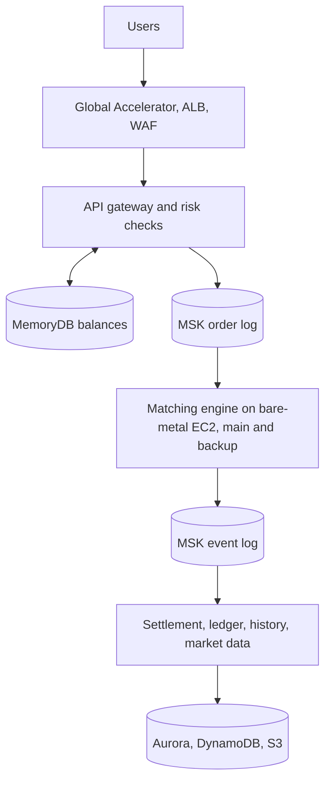

# Problem 1: Building a Castle in the Cloud

A crypto trading system on AWS: 500 requests per second, 99% of orders answered within 100ms of reaching our region.
It runs in one AWS region across 3 data centers (AZs), with a second region as a backup.
It covers orders, matching, market prices and balances. It does not cover wallets, loans or bank money.

## How it works

- **One matching engine per coin pair**, in memory on a bare-metal EC2 server, each on its own CPU core.
- **Every order is saved in a log first.** A backup engine reads the same log and takes over in 2 seconds.
- **Money is put on hold before an order is matched**, then settled later from the log. Repeated orders are ignored.
- **Speed (estimate):** 14ms checks + 24ms log writes + 3ms matching + 7ms reply + 30ms spare = 78ms.

## Services and why

| Need | Chosen | Not chosen | Why |
| --- | --- | --- | --- |
| Matching engine | Bare-metal EC2, own CPU cores | EKS, Slurm | Nothing sits between the engine and the CPU; Slurm is for batch jobs |
| Other services | EC2 Auto Scaling groups | EKS | Fewer parts to run; broken servers are replaced automatically |
| Order log | MSK | Kinesis, SQS | Kinesis is slower; SQS cannot replay old messages |
| Balances | MemoryDB | ElastiCache | ElastiCache can lose data if a server fails |
| Ledger | Aurora PostgreSQL | DynamoDB | Auditors need SQL |
| Live prices | CloudFront, NLB | API Gateway WebSocket | Too expensive per message |
| Server network | Normal AWS network | InfiniBand | AWS does not offer it, and it would save under 1ms |

## Uptime and cost

- One AZ fails: back in under 30 seconds. Whole region fails: a person switches to the backup (about 15 minutes).
- About 11,800 USD per month; the 2 bare-metal engine servers are 3,400 of that. Savings Plans and Spot cut costs.

## Scaling

| When | Do this |
| --- | --- |
| One coin pair gets busy | Give it its own CPU core on the engine server |
| Replies get slow | Add more servers |
| One customer slows others | Split the system into separate copies (cells) |
| We open new regions | Each region runs its own coin pairs |
