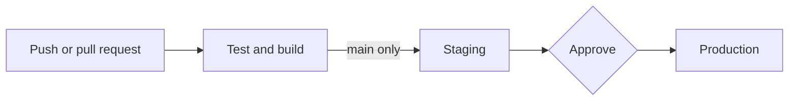

# Problem 4: Ship It Twice

Each commit is **built once**. The same build goes to staging first, then to production.

## Files

| File | What it does |
| --- | --- |
| `.github/workflows/backend.yml` | API: test and build, then deploy to staging, then production |
| `.github/workflows/frontend.yml` | Website: the same steps, deploying to S3 and CloudFront |
| `.github/dependabot.yml` | Weekly updates for the pinned actions and npm packages |

Each workflow has 3 jobs: `test`, `staging` and `production`. Production reuses the staging steps through a YAML
anchor (`&deploy`, `*deploy`), so the two never drift. GitHub only runs `.github` from the repo root.

## Assumptions

- The apps live in `backend/` and `frontend/` (not part of this task), with `lint`, `test` and `build` scripts.
- GitHub environments `staging` and `production` hold the `vars` the workflows read; `production` requires a
  reviewer (this needs a public repo or GitHub Enterprise).
- Terraform made, per environment: S3 buckets, CloudFront, an OIDC role for GitHub (no passwords), and an Auto
  Scaling group running the API as an `api` service. The load balancer checks `/healthz`, which returns the commit.
- For safe rollouts, the group uses the load balancer's health checks and starts on a numbered launch template
  version (needed for automatic rollback).

## Pipeline

- **Backend:** upload the build to S3, then an Auto Scaling instance refresh starts new servers with it. Old servers
  stop only after the new ones pass health checks; if they never do, AWS rolls back. No CodeDeploy needed.
- **Frontend:** upload to S3 with `index.html` last, so no page links to a missing file. Then clear the CDN cache.
- **After each deploy**, a smoke test checks that the new commit is really live.

## Why it is production ready

| What | How |
| --- | --- |
| Tested | Lint, tests, security audit and build must pass |
| Approved | Production needs a reviewer and only deploys from `main` |
| Same build everywhere | Deploy jobs never rebuild |
| No stored passwords | OIDC; each job gets only the access it needs |
| Locked versions | Actions pinned to exact versions; Dependabot updates them |
| Safe | One deploy at a time per environment; every job has a time limit |
| Rollback | Automatic for the backend; for both apps, re-run the last good production job (within 30 days) |

Not included: Terraform in the pipeline, canary releases, end-to-end tests, database changes, build signing.
