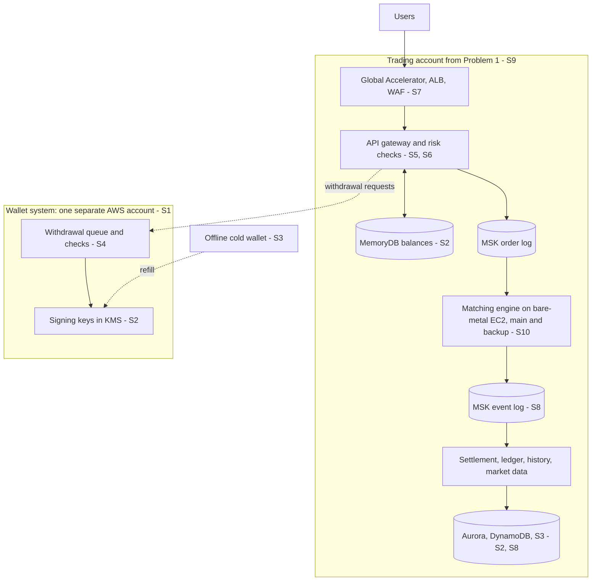

# Problem 5: Fortify the Castle

This is the Problem 1 design with security added; each change is marked S1 to S10 on the Problem 1 diagram.
"Account" means one of the company's few AWS accounts (not one per wallet), so a break-in stays in one.
Assumed until lawyers, the board and an insurer confirm: a US license, our own wallets, no insurance, a small team.

## Changes

| ID | Change | Why |
| --- | --- | --- |
| S1 | Use AWS Organizations for one separate AWS account that runs the wallet system | Hackers in trading cannot reach the keys; trading can only leave withdrawal requests |
| S2 | Use AWS KMS for the online signing keys and to encrypt the databases | Nobody can copy a key out; stolen data cannot be read |
| S3 | Use offline hardware wallets for 95% of the coins, signed by 3 of 5 staff | A hack can only reach the small online part |
| S4 | Use an SQS FIFO queue for withdrawal requests, checked before any payout | Each payout needs the user's passkey, a daily limit and a balance re-check; new addresses wait 48 hours |
| S5 | Use Amazon Cognito passkeys for login, not SMS codes | Stops phishing and SIM-swap attacks |
| S6 | Use scoped API keys in the API gateway, with withdrawals off by default | A stolen API key cannot take money out |
| S7 | Use AWS Shield Advanced and WAF for DDoS protection and rate limits | Floods and password guessing are stopped before they reach us |
| S8 | Use S3 Object Lock for a copy of every trade record | Nobody can change or delete trade history |
| S9 | Use IAM Identity Center for staff logins, with two people for risky changes | No shared passwords; one person cannot act alone |
| S10 | Use AWS Systems Manager for admin access to the engine servers | No SSH and no internet on those servers; every admin action is logged |

## Left out on purpose

| Left out | Trade-off we accept |
| --- | --- |
| Extra checks between the order log, matching engine and settlement | Orders stay fast; S9 and S10 limit who can reach them instead |
| Automatic switch to the backup region | A person decides, so a network split cannot run two engines; recovery takes about 15 minutes |
| Wallet system in the backup region | Withdrawals pause during a regional outage, while trading still fails over |
| Advanced signing (MPC) and secure enclaves | Costly now; keeping little money online limits any loss |

**Order of work** (what we secure first, and what can wait):
- **Before launch (must have):** all of S1 to S10 except Shield Advanced, plus creating the wallet keys with witnesses
  and an outside hacking test. Money and accounts are attacked from day one, and stolen coins cannot be returned.
- **Within 90 days:** Shield Advanced, price limits on orders, a bug bounty. Free basic DDoS protection covers launch.
